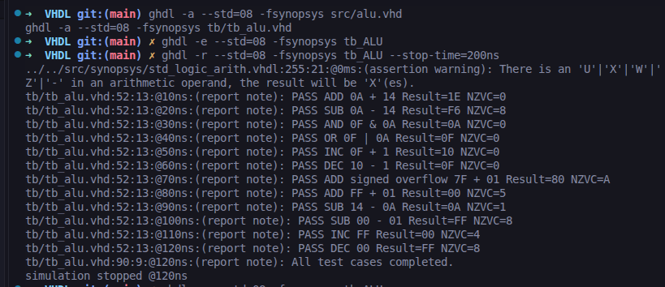
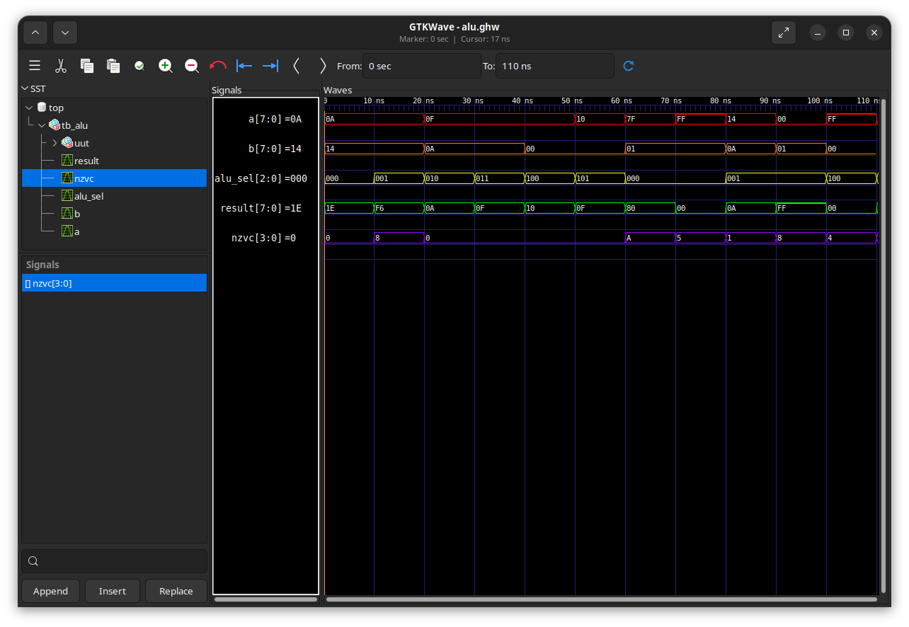
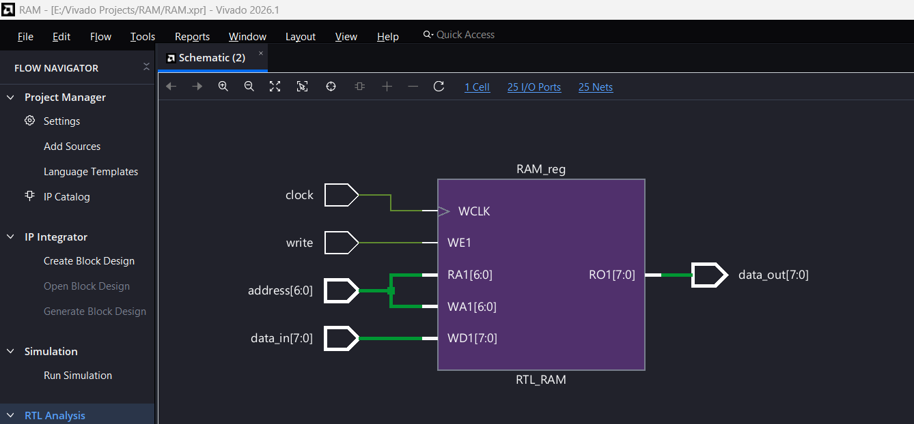
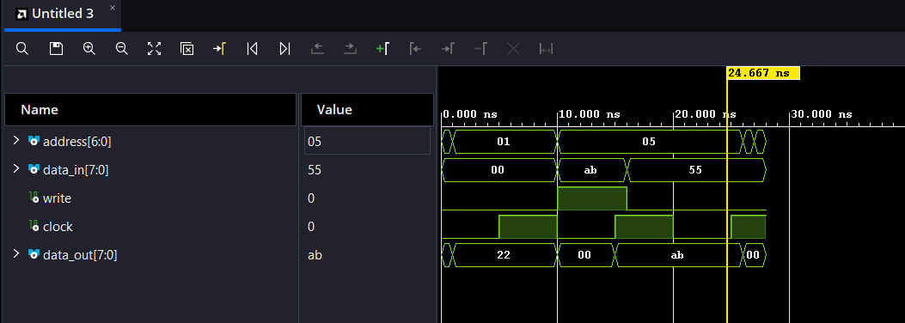

# 8-Bit ALU in VHDL

An 8-bit Arithmetic Logic Unit (ALU) implemented in VHDL and verified using GHDL simulation and GTKWave waveform analysis.

This project is being developed incrementally to explore digital logic design, arithmetic operations, status flags, and hardware verification.

## Current Status

- [x] Implemented an 8-bit ALU
- [x] Implemented arithmetic and bitwise logical operations
- [x] Implemented NZVC status flags
- [x] Created a VHDL testbench
- [x] Passed 12 simulation test cases
- [x] Inspected simulation waveforms using GTKWave
- [x] Organized source code, testbench, and simulation folders
- [ ] Implement XOR and NOT operations
- [ ] Implement logical shift-left and shift-right operations
- [ ] Expand the operation selector to support all planned operations
- [ ] Extend test coverage for additional operations

## Project Structure

```text
VHDL/
├── src/
│   └── alu.vhd          # ALU implementation
├── tb/
│   └── tb_alu.vhd       # ALU testbench
├── sim/
│   └──                 # Saved waveform layouts (planned)
├── .gitignore           # Excludes generated files
└── README.md            # Project documentation
```

Generated simulation files, such as `alu.ghw` and `work-obj08.cf`, are not intended to be committed to version control.

## Supported Operations

The ALU takes two 8-bit inputs, `A` and `B`, and a 3-bit operation selector, `ALU_Sel`. It produces an 8-bit `Result` and four status flags.

| `ALU_Sel` | Operation | Description |
|---|---|---|
| `000` | ADD | Adds `A` and `B` |
| `001` | SUB | Subtracts `B` from `A` |
| `010` | AND | Bitwise AND of `A` and `B` |
| `011` | OR | Bitwise OR of `A` and `B` |
| `100` | INC | Increments `A` by 1 |
| `101` | DEC | Decrements `A` by 1 |
| `110` | Default | Falls back to addition |
| `111` | Default | Falls back to addition |

The default selector cases will be replaced as additional operations are implemented.

## Status Flags: NZVC

The `NZVC` output is a four-bit vector, ordered from most significant bit to least significant bit.

| Flag | Name | Meaning |
|---|---|---|
| `N` | Negative | Copies the most significant bit of the result |
| `Z` | Zero | Set when the result is `00` |
| `V` | Overflow | Indicates signed overflow for addition or subtraction |
| `C` | Carry | Carry-out for addition; no unsigned borrow for subtraction |

For operations other than addition and subtraction, the current implementation sets `V` and `C` to `0`.

## Tools Used

- **VHDL** — Hardware description language
- **GHDL** — VHDL compiler and simulator
- **GTKWave** — Waveform visualization
- **Git** — Version control

The current implementation uses Synopsys arithmetic packages, so the GHDL commands use the `-fsynopsys` option.

## Getting Started

The following commands assume Ubuntu or another Linux environment with GHDL installed and that the terminal is opened at the repository root.

### 1. Install the tools

```bash
sudo apt update
sudo apt install ghdl gtkwave
```

### 2. Analyze the VHDL source and testbench

```bash
ghdl -a --std=08 -fsynopsys src/alu.vhd
ghdl -a --std=08 -fsynopsys tb/tb_alu.vhd
```

### 3. Elaborate the testbench

```bash
ghdl -e --std=08 -fsynopsys tb_ALU
```

### 4. Run the simulation

```bash
ghdl -r --std=08 -fsynopsys tb_ALU --stop-time=200ns
```

The current testbench completes at approximately `120 ns` and reports the results of its test cases in the terminal.

### 5. Generate a waveform

```bash
ghdl -r --std=08 -fsynopsys tb_ALU \
  --wave=alu.ghw --stop-time=200ns
```

Open the generated waveform in GTKWave:

```bash
gtkwave alu.ghw
```

Add the following signals to the waveform display:

- `A`
- `B`
- `ALU_Sel`
- `Result`
- `NZVC`

Hexadecimal display is useful for `A`, `B`, and `Result`, while binary display makes the operation selector and status flags easier to interpret.

Generated waveform files are ignored by Git and can be recreated at any time.

## Verification

The current testbench contains 12 test cases. All 12 passed in the latest recorded simulation.

The tests cover:

- Addition and subtraction
- Bitwise AND and OR
- Increment and decrement
- Signed overflow during addition
- Carry-out during addition
- Unsigned borrow behavior during subtraction
- Zero and negative result flags
- 8-bit arithmetic wraparound

### Example Results

| Test case | Inputs | Expected result | Observed result |
|---|---|---|---|
| Addition | `0A + 14` | `1E` | `1E` |
| Subtraction | `0A - 14` | `F6` | `F6` |
| AND | `0F AND 0A` | `0A` | `0A` |
| OR | `0F OR 0A` | `0F` | `0F` |
| Increment | `FF + 1` | `00` | `00` |
| Decrement | `00 - 1` | `FF` | `FF` |

The simulation waveforms were also inspected to verify the changes in operands, operation selection, results, and status flags over time.

## Simulation Results

The ALU was simulated using GHDL, and its behavior was inspected using GTKWave.

### Testbench Output

The testbench currently includes 12 test cases covering arithmetic operations, logical operations, status flags, overflow, carry, borrow, and 8-bit wraparound.

All 12 test cases passed in the latest recorded simulation.



### GTKWave Simulation

The waveform below shows the ALU inputs (`A`, `B`), operation selector (`ALU_Sel`), output (`Result`), and status flags (`NZVC`) changing during the simulation.



### Representative Results

| Operation | Inputs | Result | NZVC |
|---|---|---|---|
| ADD | `0A + 14` | `1E` | `0` |
| SUB | `0A - 14` | `F6` | `8` |
| AND | `0F AND 0A` | `0A` | `0` |
| OR | `0F OR 0A` | `0F` | `0` |
| ADD with signed overflow | `7F + 01` | `80` | `A` |
| ADD with carry-out | `FF + 01` | `00` | `5` |
| INC | `FF + 1` | `00` | `4` |
| DEC | `00 - 1` | `FF` | `8` |

The `NZVC` values are displayed in hexadecimal. For example, `A` represents `1010` (negative and overflow set), while `5` represents `0101` (zero and carry set).

## Planned Improvements

1. Implement XOR and bitwise NOT.
2. Implement logical shift-left and shift-right.
3. Expand `ALU_Sel` from 3 bits to 4 bits to assign distinct codes to all ten planned operations.
4. Add test cases for every new operation and its boundary conditions.
5. Investigate and eliminate the arithmetic warning observed during initial simulation.
6. Integrate additional operations with the microcontroller's instruction decoder and control logic if instruction-level support is required.

## Learning Objectives

This project provides practical experience with:

- Combinational digital logic
- Fixed-width arithmetic
- Signed overflow and unsigned carry/borrow
- VHDL testbench development
- Simulation-driven verification
- Timing waveform analysis
- Version control and project organization

---

**Project status:** In progress — core ALU operations implemented and verified through simulation.

## RAM Module (96x8)

The microcontroller data memory is implemented as a synchronous 96x8 RAM module. It supports a 7-bit address bus, an 8-bit write data bus, and a write-enable signal. On each rising clock edge, data is written into the selected memory location when `write = '1'`; otherwise the current memory value is preserved.

### RAM Features

- 96 locations of 8-bit memory
- 7-bit address input (`address(6 downto 0)`)
- 8-bit data input (`data_in`)
- Synchronous write operation using the clock signal
- Read output available continuously via `data_out`
- Initialized memory values included for simulation and testing

### VHDL Implementation

```vhdl
library IEEE;
use IEEE.STD_LOGIC_1164.ALL;
use IEEE.STD_LOGIC_ARITH.ALL;
use IEEE.STD_LOGIC_UNSIGNED.ALL;

entity rw_96x8_sync is
    port(
        address : in std_logic_vector(6 downto 0);
        data_in : in std_logic_vector(7 downto 0);
        write   : in std_logic;
        clock   : in std_logic;
        data_out: out std_logic_vector(7 downto 0)
    );
end rw_96x8_sync;

architecture Behavioral of rw_96x8_sync is
    type data_mem is array (0 to 95) of std_logic_vector(7 downto 0);
    signal RAM : data_mem := (
        x"33", x"22", x"00", x"00",
        x"00", x"00", x"00", x"00",
        x"00", x"00", x"00", x"00",
        x"00", x"00", x"00", x"00",
        x"00", x"00", x"00", x"00",
        x"00", x"00", x"00", x"00",
        x"00", x"00", x"00", x"00",
        x"00", x"00", x"00", x"00",
        x"00", x"00", x"00", x"00",
        x"00", x"00", x"00", x"00",
        x"00", x"00", x"00", x"00",
        x"00", x"00", x"00", x"00",
        x"00", x"00", x"00", x"00",
        x"00", x"00", x"00", x"00",
        x"00", x"00", x"00", x"00",
        x"00", x"00", x"00", x"00",
        x"00", x"00", x"00", x"00", 
        x"00", x"00", x"00", x"00",
        x"00", x"00", x"00", x"00",
        x"00", x"00", x"00", x"00",
        x"00", x"00", x"00", x"00",
        x"00", x"00", x"00", x"00",
        x"00", x"00", x"00", x"00",
        x"00", x"00", x"00", x"00"
    );
begin
    process(clock)
    begin
        if rising_edge(clock) then
            if write = '1' then
                RAM(conv_integer(unsigned(address))) <= data_in;
            end if;
        end if;
    end process;

    data_out <= RAM(conv_integer(unsigned(address)));
end Behavioral;
```

### RAM Testbench Summary

A dedicated testbench was created to validate read, write, and preservation behavior of the RAM module.

```vhdl
-- Test 1: Check initial value at address 0
address <= "0000000";
assert data_out = x"33"
    report "FAIL: Initial value at address 0"
    severity failure;

-- Test 2: Check initial value at address 1
address <= "0000001";
assert data_out = x"22"
    report "FAIL: Initial value at address 1"
    severity failure;

-- Test 3: Write AB to address 5
address <= "0000101";
data_in <= x"AB";
write <= '1';
wait until rising_edge(clock);
assert data_out = x"AB"
    report "FAIL: Write/read at address 5"
    severity failure;

-- Test 4: Write disabled, value should remain unchanged
write <= '0';
data_in <= x"55";
wait until rising_edge(clock);
assert data_out = x"AB"
    report "FAIL: RAM changed when write was disabled"
    severity failure;
```

### Vivado / Schematic Validation

The RAM module was verified in Vivado and confirmed to behave correctly in simulation and synthesis flow.



### RAM Simulation Results

The memory module was tested for initial values, write access, protected writes, and data retention behavior. The waveform confirms the expected read/write timing and memory state transitions.



### Verification Outcomes

The RAM testbench checks the following:

- Initial memory contents at known addresses
- Correct write operation at a selected address
- Correct readback after write
- Data retention when `write = '0'`
- Unaffected values in neighboring memory locations

All RAM tests passed successfully in the Vivado verification flow.

---

**Project status:** RAM module implemented, verified, and documented alongside the completed ALU section.
